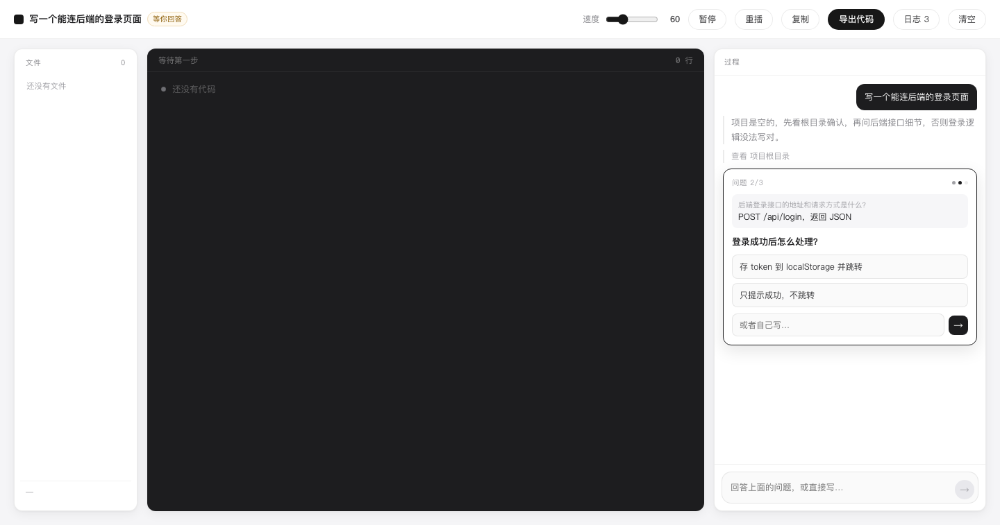
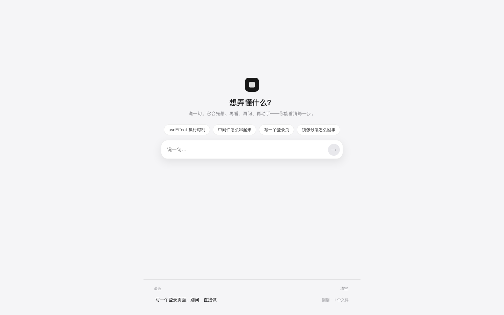
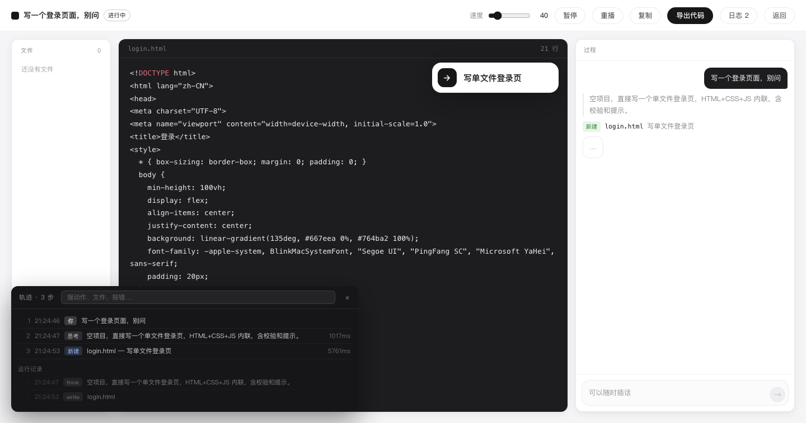

# Step Coding

> 说一句，它先想、再看、再问、再动手——你能看清每一步，也能随时叫停。


---

## 它做什么

一个小项目里的 agent，动作全程可见：

```
我想…      项目是空的，先看根目录确认，再问登录页的技术栈和风格。
查看        项目根目录
提问        登录页要什么形式？
            ○ 纯静态 HTML+CSS+JS（本地假校验）
            ○ HTML 页面 + 简单后端接口
            ○ 只要 HTML+CSS 静态展示
            或者自己写…
计划        1 写登录页 HTML 结构   2 写样式 CSS   3 写前端校验 JS
新建        index.html   登录页结构
新建        style.css    登录页样式
新建        app.js       前端校验逻辑
完成        写好了静态登录页，含前端校验和演示登录。
自检        3 个文件，91 行 · 检查通过，没发现问题
```

## 一轮是"一次工具调用"

用的是真正的 function calling：工具用 JSON Schema 声明，模型返回 `tool_calls`，
参数由协议保证结构，正文不再塞进 JSON 字符串里。

| 工具 | 作用 |
|---|---|
| `think` / `plan` | 说出正在确认什么、接下来几步 |
| `look` | 读项目 |
| `search` | 联网查资料 |
| `ask` | 缺关键信息时提问（1/n 逐个问） |
| `say` / `finish` / `decline` | 回话、收工、礼貌拒绝 |
| `write_file` / `edit_file` / `delete_file` | 真正改文件 |

每轮只调用一个工具，前端拿到一个、播完、再要下一个。**不会一上来把所有文件都建好。**

## 为什么要这么设计

一开始我做的是"一轮交回一整批文件"，结果是：

- 没有过程，你不知道它在干什么，也不知道它为什么这么干
- 中途没法插话，要改只能等它做完
- 改一行也要整份重写

改成单动作循环后，这三件事同时消失。代价是每轮多一次模型调用——但用户看到的是**过程**，不是等待。

## 改东西是"改"，不是"重写"

```
你      在登录按钮下面加一行注册链接
修改    index.html   按钮下加注册链接
新增    register.html
```

`edit` 只动 `find` 到 `replace` 那一段。后端会先按顺序模拟一遍，确认 `find` 能在当前内容里逐字找到；找不到就让模型重试一次。

## 缺信息才追问，一问一答

`ask` 支持一次列多个问题，界面按 1/n 逐个问，答完一次性回给模型：



什么时候该问，判据只有一条：**缺了某个信息就没法正确开工**。

- 该问：要连真实接口但没有地址/密钥、技术栈决定完全不同的实现、
  两种理解都说得通、要删除或覆盖已有内容
- 不该问：配色、文件命名、目录层级——自己定
- "你想做什么"这种开放问题用 `say` 问，不要做成选项

## 寒暄就好好说话

协议里补了 `say`（只回一句话、不给选项）。之前没有这个动作，模型想说话只能调
`ask`，于是「你好」变成了一张问卷：

```
你   你好
它   你好，项目是空的。想做什么？写页面、小工具、脚本都行，说个大概我来搭。
```

`ask` 现在只用于真有分岔路口的决策（技术栈、要不要后端、需要密钥）。

## 超出范围：不关门，把需求翻译成能做的事


拒绝是一个**方法**，不是一张话术模板：

1. **先说中对方的真实目的**（证明听懂了）——「你想知道今天发生了什么大事」
2. **只否定做不到的那一小块**，一句话——「这个我确实查不了，我没有实时新闻源」
3. **立刻给 1～3 个用代码能达到同一目的的做法**——「接新闻聚合接口做页面 /
   写脚本定时抓 RSS / 做个每日摘要小站」
4. 不道歉三遍、不说教

左边这些建议**可以直接点**，而且只能点一次：选中的那条划掉，其余变灰，
不会再被点第二次。

提示词里没有写死「新闻」「翻译」「英语」这些词，只有这个四步方法——
所以换个领域也能推出来。

## 卡住就问，不猜

需要用户决定的事（技术栈、风格、密钥、外部服务），模型会 `ask`，界面弹出一张卡：

- 2～4 个选项，点一下就继续
- 也可以自己写

运行中随时可以插话，话会进上下文，下一轮生效。

## 联网搜索

默认用 **DeepSeek 自研 Search API**，和模型同一个 key，不用再注册别家：

```
POST https://api.deepseek.com/v1/tools/search
{ "query": "...", "count": 5, "need_content": false }
```

**¥5 / 1000 次成功请求**；失败、无结果、超时都不计费（[官方文档](https://api-docs.deepseek.com/zh-cn/guides/search)）。

也可以用别的后端，改环境变量即可：

```bash
SEARCH_PROVIDER=deepseek   # 默认，用 DEEPSEEK_API_KEY
SEARCH_PROVIDER=serper     # 2500 次免费，之后 $1/千次
SEARCH_PROVIDER=bocha      # 国内直连，约 ¥5/千次
SEARCH_API_KEY=...
```

没配 key 时整条链路关闭，prompt 里也会告诉模型"没有搜索能力，不要用 search"。

**搜不搜由模型自己判断**，不是每个问题都搜。问它「asyncio.gather 和 TaskGroup 区别」
它会直接答完收工；问它「写个调 DeepSeek 搜索接口的页面」，它才会先查文档。

搜索是两段式的：先把「正在搜」推到界面（转圈），搜完再把来源补到同一张卡上。


它会搜两次、发现「浏览器直连会暴露 key 且有 CORS」，然后停下来问你要哪种跑法。

## 最近

**一次进来 = 一个项目。** 后面加文件、删文件、改内容，都还是同一条记录，
不会每动一次就多一条。

标题自动取你说的第一句话。点开旧记录时，前端先向服务端同步 `seq / messages / files`，
再接着问下一步——不会出现"第一句话被回放吞掉"的情况。

（点到某条旧记录继续改，也是更新那一条。）



## 跑的时候不接收输入

想说话就先**暂停**——输入框在运行期间是禁用的。这样不存在"我说的话被塞进
哪一轮"的不确定性，也没有排队合并。

## 中途离开，回来接着做

整个现场（过程、文件、对话、当前问号）实时存在 localStorage：

- 点「返回」→ 回首页，现场留着，首页出现「上次没做完」卡片
- 卡片右侧：铅笔 = 接着做，垃圾桶 = 不要了（鼠标移上去才显示）
- 直接刷新 / 关掉页面 → 再来也是这张卡
- **正常结束时不会弹这张卡，也不会自动再发一轮**；要回看从「最近」里点

「暂停」和「返回」是两件事：

| | 作用 | 回来时 |
|---|---|---|
| 暂停 | 停住画面，也停住循环（不再请求下一步） | 还在这页，点继续接着跑 |
| 返回 | 回首页，现场冻结 | 首页出现续做卡（铅笔继续） |

## 不许"说做了其实没做"

`say` 只用于对话，不能拿来汇报"已经写好"。后端会做一次检查：
回复里提到某个文件却不在项目里，就当场把话退回去，逼它真的给出 `write`
或 `edit`——不会再出现"写了 quicksort.js"但项目里空空如也。

## 轨迹

「轨迹」面板按步列出：序号、时间、动作、详情、模型调用耗时；报错和拒绝标红，
可以搜索。下面还挂着原始运行记录，出问题能定位到具体哪一步。



## 滚动不抢你的滚轮

代码区一边写一边往下跟，过程区有新内容也往下跟——**但只要你手动往上滑过，
就立刻停手**，不再把你拽回去。滑回底部，跟随自动恢复。

## 循环为什么稳

- **会话在服务端**：每轮只发 `session_id` + `seq` + 这条用户消息，不再把整份对话
  和整份文件来回搬（实测请求体从 12KB 降到 80 字节）
- **服务端只回变化的文件**（changed），不整份回传
- **幂等**：同一 `seq` 重发直接回放上次结果，所以客户端可以放心重试；
  网络抖一下不会把这一轮跑两遍
- **单一驱动**：只有一个 `pump()` 循环在推进，没有多个 setTimeout 抢着请求
- **同一会话串行**：服务端每个会话一把锁，超时后的重试不会让同一轮跑两遍
- **动画不阻塞循环**：模型返回就继续，播放器只负责把变化演出来；新动作到达时
  上一段直接收尾，不会因为"打字慢"把后面的步骤堵住
- **会话落盘**：服务重启后还能用 `/api/session` 把现场接回来

## 出错怎么查

前端右上角「日志 N」记录每次发送、事件和状态迁移（`?trace=1` 默认展开）。
后端没有额外埋点：排障看 uvicorn stdout 和 `var/sessions/<id>.json`（能直接看到 messages / files / last_event）。

```
17:58:23  send      写一个登录页面
17:58:23  think     项目是空的，先看根目录
17:58:24  ask       登录页要什么形式？
17:58:31  plan      3 步
17:58:33  write     index.html
```

模型调用默认 180 秒超时；429 / 5xx 自动重试一次；输出被 `max_tokens` 截断时，
会提示模型把文件拆小再试，而不是把半截 JSON 当成合法参数。

---

## 跑起来

```bash
python3 -m venv .venv
.venv/bin/pip install -r requirements.txt
cp .env.example .env          # 填 DEEPSEEK_API_KEY
cd web && pnpm install && pnpm build && cd ..
.venv/bin/python -m uvicorn backend.main:app --port 8790
open http://127.0.0.1:8790
```

纯网页，生成的代码不碰本地磁盘、不执行命令。服务端只把会话存在 `var/sessions/`。

可调参数（都有默认值，写在 `.env` 里即可）：

```bash
LLM_TIMEOUT=180       # 单次模型调用超时（秒）
LLM_MAX_TOKENS=6000   # 单次输出上限；大文件被截断就往上调
LLM_RETRIES=1         # 超时 / 429 / 5xx 的重试次数
```

## 测试

```bash
.venv/bin/pip install -r requirements-dev.txt
.venv/bin/python -m pytest -q
```

用脚本化的假模型跑断言，**不花 API 费用**，覆盖：

- 动作参数校验、`write` 覆盖保护、`edit` 必须逐字命中
- 幂等 `seq`、回放、会话恢复、同一 `seq` 并发只执行一次
- 模型超时 / 5xx 重试、输出截断检测
- 完整一轮：`think → plan → write → finish`，以及「说写了其实没写」的守卫

真实模型的「任务通过率」是另一层评测：固定任务集 + 期望动作/最终文件断言，
需要 API key；主观质量才需要 LLM 裁判或人工抽检。前端目前靠 `pnpm build`（含 `tsc`）
加 headless Chrome 点测，等拆 `App.tsx` 时再引 Vitest。

## 结构

```
backend/
├── main.py      /api/session、/api/step：会话、幂等 seq、并发锁
├── agent.py     唯一的循环：调模型 → 执行工具 → 回事件
├── tools.py     工具 schema（唯一一份）
├── actions.py   tool_call → 内部动作，参数校验
├── prompt.py    系统提示词
├── context.py   look 用的项目清单 / 正文
├── fs.py        文件操作与写入 / 编辑保护
├── guards.py    撒谎守卫 + 重复守卫
├── session.py   会话：内存 LRU + 落盘 + 增量 diff + id 校验
└── search.py    联网搜索

web/src/
├── App.tsx      驱动循环、三栏布局、时间线、历史 / 恢复
├── player.ts    把 write/edit 演出来（逐字、可在中间插入）
├── check.ts     写完自检：引用、类名、id、括号
└── zip.ts       导出代码

tests/           断言 / 回归测试（假模型，不花钱）
```

## 它不做什么

| | 为什么 |
|---|---|
| 不跑代码 | 要的是看懂，不是部署 |
| 不执行本地命令 | 生成的代码在浏览器内存里，只有导出才下载 |
| 不做账号 / 进度 | 它不是课程 |
| 默认不引框架 | 小例子引框架，噪音比内容多 |