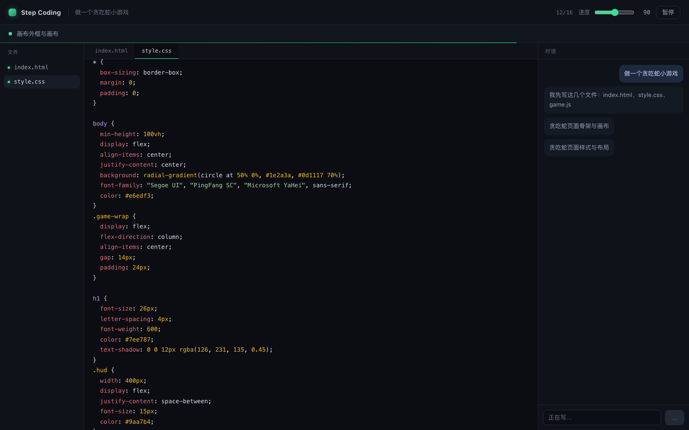
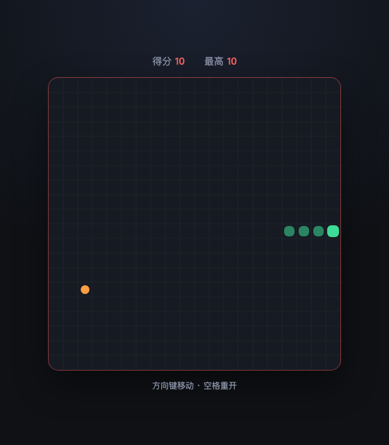
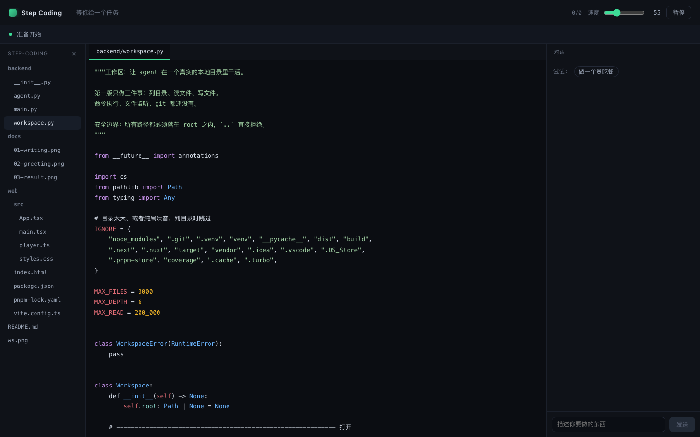
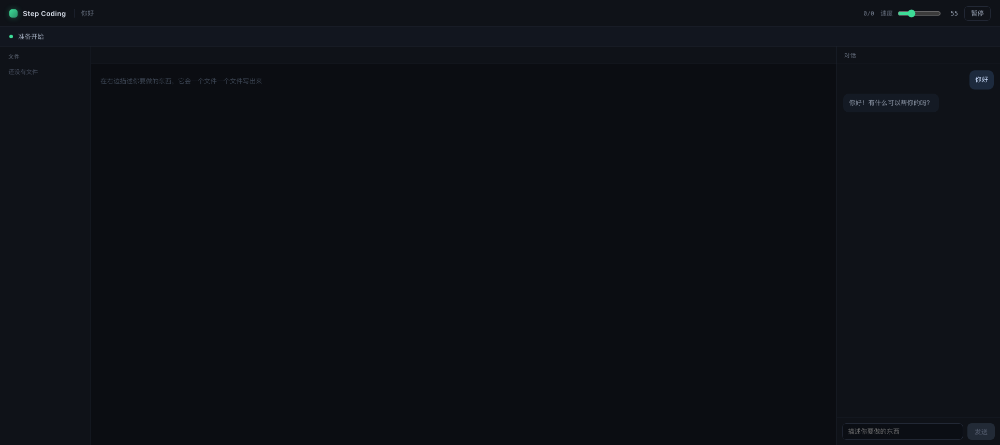

# Step Coding

> AI 写代码太快，快到你看不清它在做什么。
> 这个原型试着反过来：让它**按人的速度**写，一个文件一个文件，你能看着。



---

## 它是怎么跑的

你说一句任务，它做四件事：

```
你：做一个贪吃蛇小游戏
        ↓
① 先定文件清单 → index.html、style.css、game.js
        ↓
② 逐个把文件写出来（一次只写一个）
        ↓
③ 边写边播：每写完一小段，顶部横幅换一次
        ↓
④ 写完点「查看结果」，弹出来的就是能玩的游戏
```

横幅跟着**内容**走，不是跟着文件走：

```
正在创建 style.css
  → 全局重置与背景
  → 页面居中布局
  → 记分板样式
  → 画布与遮罩
```



## 跑起来

```bash
# 1) 后端
python3 -m venv .venv
.venv/bin/pip install fastapi "uvicorn[standard]"
cp .env.example .env          # 填 DEEPSEEK_API_KEY
.venv/bin/python -m uvicorn backend.main:app --port 8790

# 2) 前端
cd web && pnpm install && pnpm build

# 3) 打开
open http://127.0.0.1:8790
```

在右下角输入框里说你要做什么。

## 打开你本地的项目

左边输入一个目录路径（比如 `/Users/you/myproject`），它会列出**真实的文件树**，点文件就能看。



打开之后，再让它写东西，文件会**真的落到这个目录里**（不再只存在浏览器内存里）。

安全边界：所有路径必须落在打开的目录内，`..` 会被拒绝；`node_modules`、`.git`、`.venv` 等默认跳过。

---

## 它不是"你说什么都开工"

说「你好」它只回一句话，不会开始建网页：



先判断意图（chat / build），再决定要不要列文件开工。

---

## 三个设计决定

### 1. 先定清单，再写文件

一开始是让模型自己决定"下一步写哪个文件"，结果是：

- 它会往 `index.html` 里塞完整的 html + css + js（一个文件全搞定）
- 写完还会不停"优化"：加暂停、加触屏、加主题……永远不结束

改成两段式之后：**先让它列出文件清单，之后每次只负责把指定的那个文件写完整**。结构定了，也一定收敛。

### 2. 一次一个文件，不是一次一行

一次一行会让模型失去全局，写出来的代码拼不起来；一次一个文件，内容完整可运行，而"慢"交给前端播放器去做。

**模型负责顺序和内容，播放器负责节奏。**

### 3. 代码不走 JSON

一开始用 `response_format: json_object` 让模型返回 `{content: "..."}`，结果代码里只要有 `"Segoe UI"` 这种双引号，JSON 就被撑破，解析失败率大约三成。

改成不依赖转义的文本协议：

```
SAY: 创建页面骨架
SECTION: 页面结构
<<<
<div class="wrap">…</div>
>>>
```

代码原样写，引号、反斜杠、模板字符串都不用管。**失败率从三成降到零。**

---

## 现在还没有的

| | 状态 |
|---|---|
| 中途打断、插话纠正 | ❌ 现在只能等它写完 |
| 终端真实执行 | ❌ 只显示打开预览 |
| 在已有代码上修改 | ❌ 只会新建文件，不会改现有文件 |
| 多页面 / 多文件类型的项目 | ⚠️ 靠模型自己定清单 |
| 断点续跑 | ❌ |
| 代码审查、修改已有文件 | ❌ 只支持从零创建 |

**这一版的目的是验证"看起来对不对"**：横幅粒度、打字节奏、文件切换，这三件事成立，才值得往下做。

---

## 目录

```
step-coding/
├── backend/
│   ├── main.py     FastAPI：/api/plan-files、/api/write
│   └── agent.py    两段式 agent（定清单 / 写文件）+ 协议解析
├── web/src/
│   ├── player.ts   播放器：节奏、状态机、队列
│   ├── App.tsx     界面 + 会话流程
│   └── styles.css
└── docs/           截图
```

## 小技巧

- `?task=做一个贪吃蛇小游戏` 直接开跑（方便演示）
- `?cps=120` 调打字速度（字符/秒）
