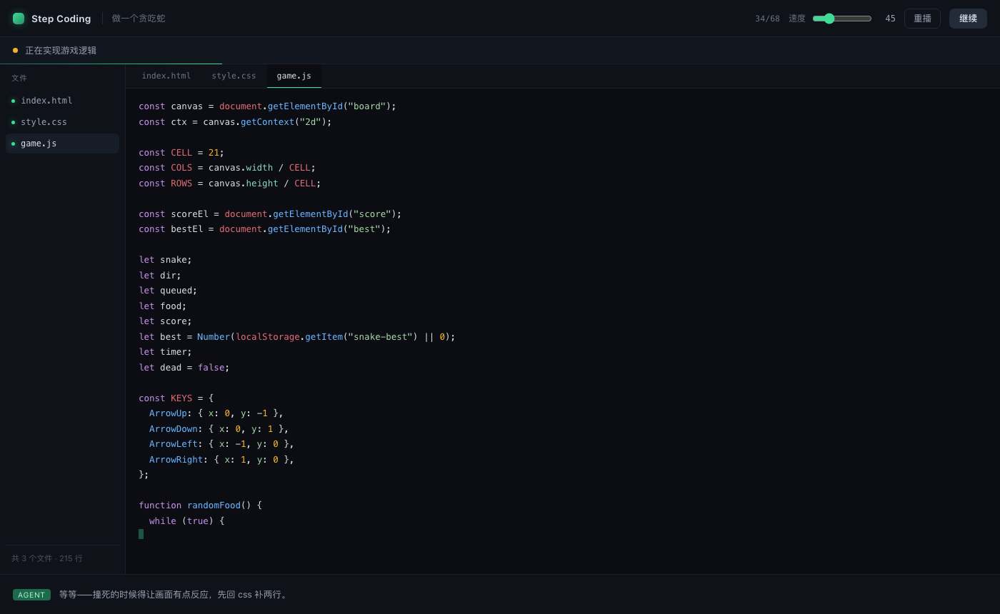

# Step Coding

> AI 写代码太快，快到你看不清它在做什么。
> 这个原型试着反过来：让它**按人的速度**写，一个文件一个文件，你能看着，也能随时打断。



---

## 它现在能做什么

打开页面，点开始，看着它把一个小游戏从零写出来：

```
做一个贪吃蛇 → index.html → style.css → game.js（写到一半跳回 css 补两行）→ 继续 → 打开预览
```

- **68 步、3 个文件、215 行**，全程可见
- 顶部横幅显示当前动作（"正在创建 style.css"）
- 左侧文件树，正在写的文件有绿点
- 代码一行一行出现，带光标、带变速
- 写完点「查看结果」，弹出来的**是真的能玩的贪吃蛇**


## 跑起来

```bash
# 后端
python3 -m venv .venv
.venv/bin/pip install fastapi "uvicorn[standard]"
.venv/bin/python -m uvicorn backend.main:app --port 8790

# 前端
cd web && pnpm install && pnpm build

# 打开
open http://127.0.0.1:8790
```

改前端时开 `pnpm dev`（5180，代理到 8790）。

---

## 三条设计决定

### 1. 步骤里的内容 = 最终的代码，一字不差

演示脚本不是手写的一堆碎片，而是**拿最终文件反过来切块**生成的。

代码里有一条不变量，可以随时验：

```bash
curl -s localhost:8790/api/plan | python3 -c "
import json,sys
d=json.load(sys.stdin)
files={k:'' for k in d['files']}
for s in d['steps']:
    if s['type']=='create': files[s['path']]=''
    if s['type']=='append': files[s['path']]+=s['text']
print(all(files[k]==d['files'][k] for k in d['files']))
"
# True
```

**演出来的东西，必须等于最后跑起来的东西。** 否则这个产品就是个动画片。

### 2. 播放器只管节奏，不管内容

`web/src/player.ts` 不产生任何代码，它只做一件事：按速度把 `append` 的文本一个字一个字吐出来。

这样"慢"和"快"就成了一个参数，而不是另一套实现。

### 3. 文件之间可以交错，文件内部必须有序

`style.css` 写到一半跳去 `game.js`，再跳回来——但每个文件自己的行顺序不变。

这样既像人（人就是来回切的），又保证了回放结果正确。

---

## 现在还没有的

| | 状态 |
|---|---|
| 真 agent loop（模型决定下一步） | ❌ 现在是固定脚本 |
| 打断后重新规划 | ❌ |
| 终端真实执行 | ❌ 只显示命令 |
| 多个任务 | ❌ 只有贪吃蛇 |
| 语法高亮以外的编辑体验 | ❌ 只读 |

**这一版的目的是验证一件事：这个交互看起来对不对。** 逻辑上的下一步是把 `build_steps()` 换成真的模型调用——前端一行都不用改，因为协议已经定死在这四种操作上了：

```json
{ "type": "create", "path": "index.html", "banner": "正在创建 index.html" }
{ "type": "append", "path": "index.html", "text": "<!doctype html>\n" }
{ "type": "open",   "path": "style.css" }
{ "type": "run",    "cmd": "npm run build" }
```

---

## 目录

```
step-coding/
├── backend/
│   ├── main.py     FastAPI：/api/plan + 静态托管
│   └── demo.py     演示内容：三个文件 + 由它们生成的步骤
├── web/src/
│   ├── player.ts   播放器（节奏/状态机/seek）
│   ├── App.tsx     界面
│   └── styles.css
└── docs/           截图
```

## 小技巧

URL 上加参数可以直接跳到某一刻，方便截图和演示：

- `?at=34` 跳到第 34 步（会暂停）
- `?cps=120` 设置打字速度
