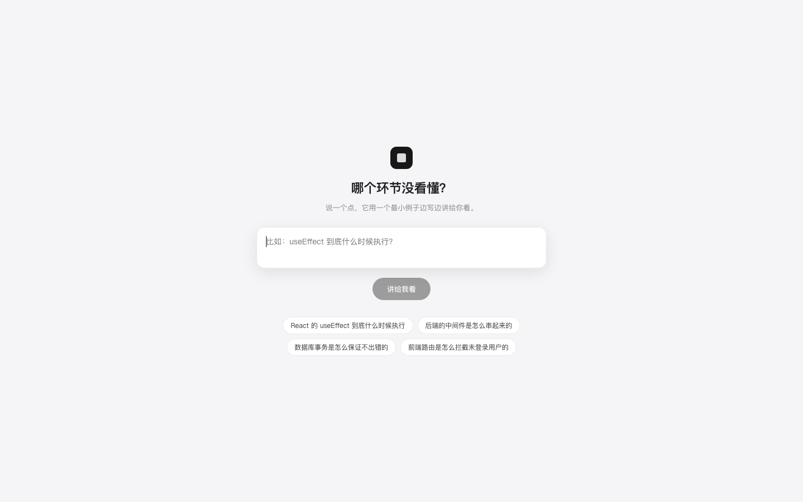
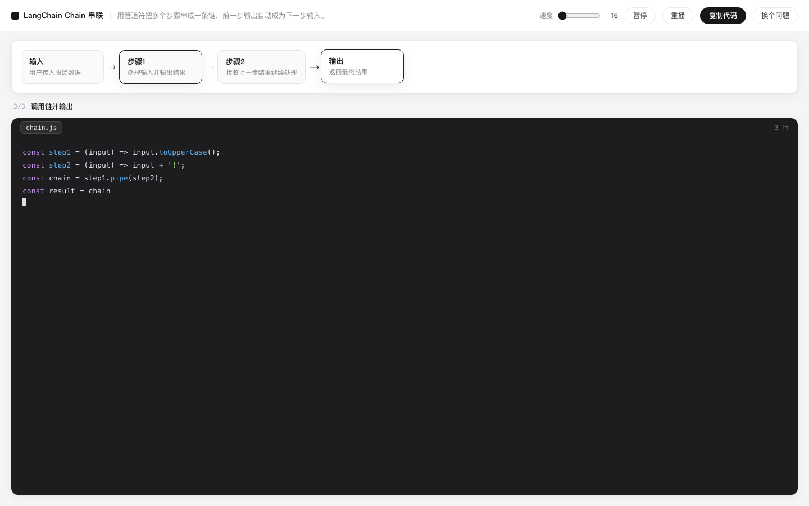
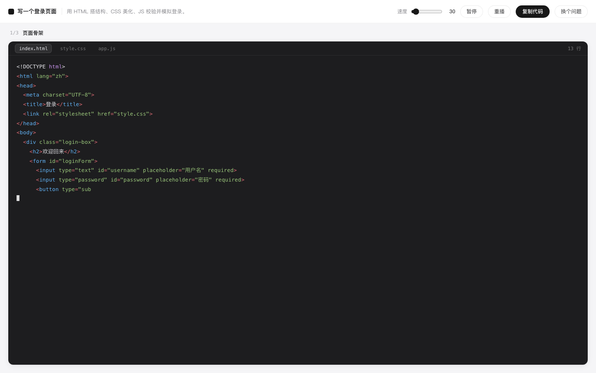

# Step Coding

> 哪个环节没看懂，说一句。它用一个最小例子，边写边讲给你看。



---

## 它解决什么

**写什么都行，只要你想看懂它长什么样。**

三种用法：

| 你想 | 它给 |
|---|---|
| 弄懂一个概念 | 「LangChain 的 Chain 怎么串起来的」→ 10 行代码 + 一条关系链 |
| 弄懂一个环节 | 「中间件是怎么串起来的」→ 4 个节点，逐段点亮 |
| 看一个界面长什么样 | 「写个登录页」→ index.html / style.css / app.js，一个个写出来 |





## 三个设计决定

### 1. 关系图是"可选"的，不是万能模板

讲流程时它给你一条关系链，每写一段对应的节点亮起：

```
[输入] ──▶ [步骤1] ──▶ [步骤2] ──▶ [输出]
                        ▲
                   正在写这一段
```

但写界面时没有"关系"可讲，这条链就不出现——**不为了一种形态牺牲另一种**。

### 1.5 只能看，不能跑

文件写出来就摆在那儿，可以切标签、可以复制。不执行、不预览。

这不是省事，是取舍：能跑就要沙箱、要依赖、要处理"为什么我的环境跑不起来"——那些和"看懂"无关。

### 2. 真实语法，但只留主干

不写伪代码（会把真实的坑抹掉），也不追求"能跑"（会带出 package.json、import、错误处理这些噪音）。

只留证明关系的那几行，其余全砍：

- ❌ import / 依赖 / 配置 / 启动脚本
- ❌ 错误处理样板、日志、注释块
- ✅ 真实语言的语法，能直接抄走

### 3. "最小"是硬约束，不是请求

生成后检查：文件 ≤ 4 个、步骤 ≤ 12 个、总代码 ≤ 160 行。超了在界面上标出来。

模型天然想写完整项目，靠 prompt 请求它"简单点"是没用的——必须用规则卡住。

---

## 跑起来

```bash
python3 -m venv .venv
.venv/bin/pip install fastapi "uvicorn[standard]"
cp .env.example .env            # 填 DEEPSEEK_API_KEY
cd web && pnpm install && pnpm build && cd ..
.venv/bin/python -m uvicorn backend.main:app --port 8790
open http://127.0.0.1:8790
```

**纯网页，不碰本地任何东西**：不读本地文件、不执行命令、不需要打开项目。

## 它不做什么

| | 为什么 |
|---|---|
| 不跑代码 | 最小例子要的是"看懂"，不是"部署" |
| 没有编辑器 | 你看的是它写，不是自己写 |
| 不做账号 / 进度 | 它不是课程 |
| 不读你的项目 | 最小示例讲通例；你的项目有它自己的写法 |
| 不做多语言深度支持 | 先让"一个环节讲清楚"这一件事成立 |

---

## 结构

```
backend/
├── main.py      FastAPI：/api/explain + 静态托管
└── explain.py   一次调用生成教案（节点 / 步骤 / 代码），并做最小性检查

web/src/
├── App.tsx      提问页 + 讲解页（关系图 + 代码播放）
├── player.ts    播放器：按速度逐字吐出，可暂停/重播
└── styles.css
```

## 小技巧

- `?q=useEffect 什么时候执行` 直接出课（方便分享和截图）
- `?cps=120` 调播放速度
