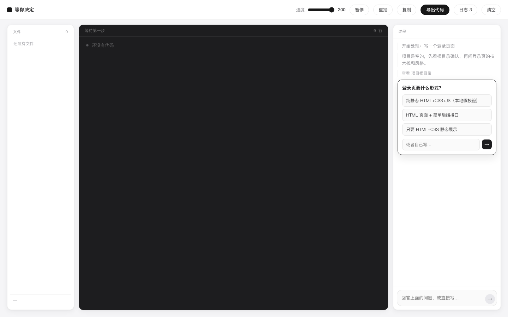
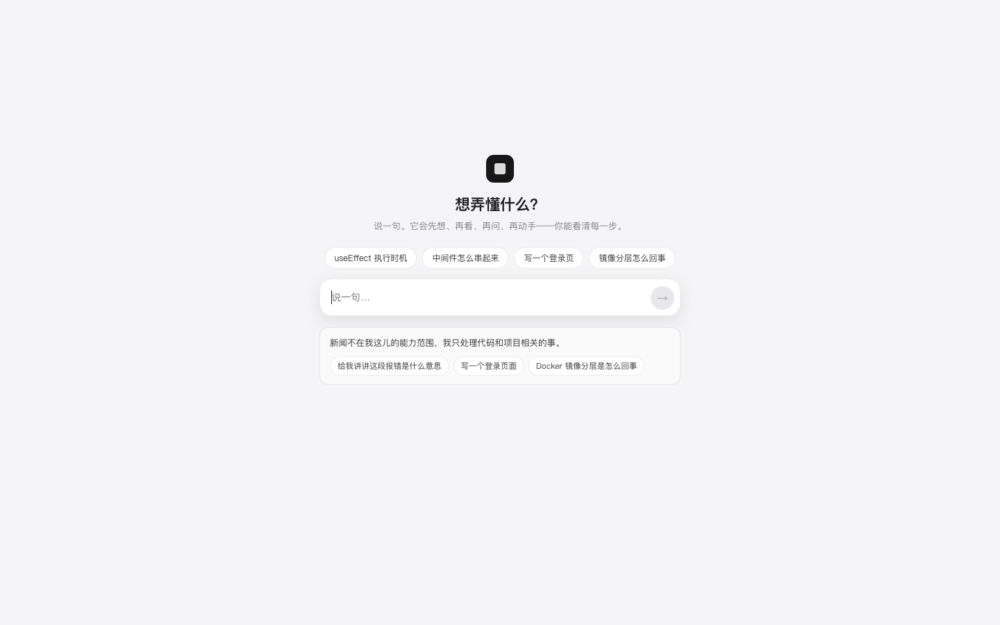
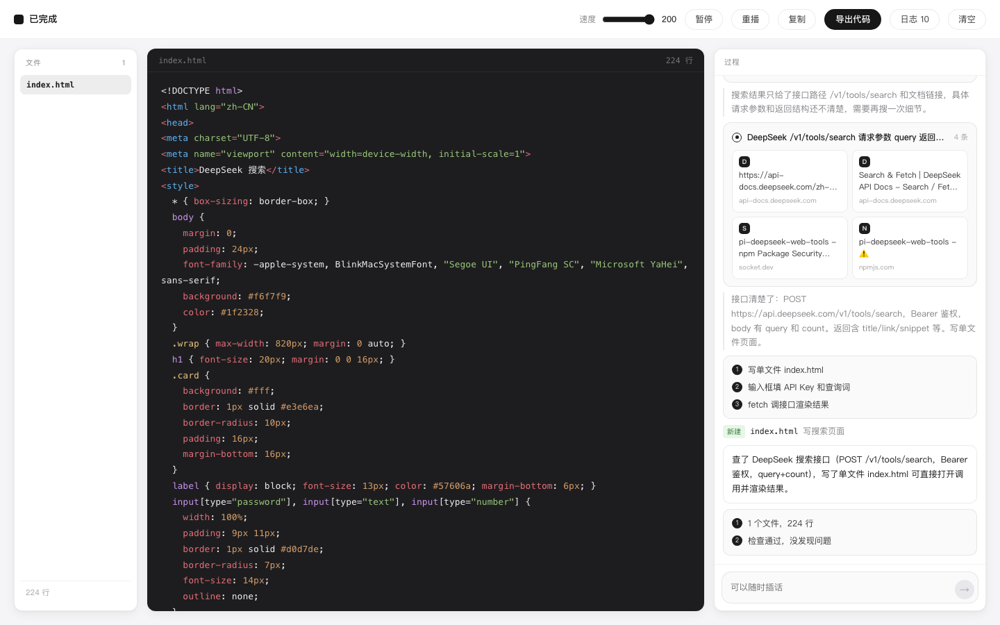

# Step Coding

> 说一句，它先想、再看、再问、再动手——你能看清每一步，也能随时叫停。



---

## 它做什么

一个小项目里的 agent，动作全程可见：

```
我想…      项目是空的，先看根目录确认，再问登录页的技术栈和风格。
查看        项目根目录
提问        登录页要什么形式？
            ○ 纯静态 HTML+CSS+JS（本地假校验）
            ○ HTML 页面 + 简单后端接口
            ○ 只要 HTML+CSS 静态展示
            或者自己写…
计划        1 写登录页 HTML 结构   2 写样式 CSS   3 写前端校验 JS
新建        index.html   登录页结构
新建        style.css    登录页样式
新建        app.js       前端校验逻辑
完成        写好了静态登录页，含前端校验和演示登录。
自检        3 个文件，91 行 · 检查通过，没发现问题
```

## 一轮是"一个动作"，不是"一整批文件"

模型每一轮只能交回**一个**动作：

| 动作 | 作用 |
|---|---|
| `think` | 说清正在确认什么、打算怎么做 |
| `look` | 读一下项目和现有文件 |
| `plan` | 列出接下来几步 |
| `ask` | 卡住了就问，带选项和自由输入 |
| `write` | 新建一个文件 |
| `edit` | 改一个文件的一段（`find` / `replace`） |
| `delete` | 删一个文件 |
| `finish` | 收工 |

前端拿到一个、播完、再要下一个。所以：**不会一上来就把文件全建好**，也不会有"批处理完才看到结果"的黑箱。

## 为什么要这么设计

一开始我做的是"一轮交回一整批文件"，结果是：

- 没有过程，你不知道它在干什么，也不知道它为什么这么干
- 中途没法插话，要改只能等它做完
- 改一行也要整份重写

改成单动作循环后，这三件事同时消失。代价是每轮多一次模型调用——但用户看到的是**过程**，不是等待。

## 改东西是"改"，不是"重写"

```
你      在登录按钮下面加一行注册链接
修改    index.html   按钮下加注册链接
新增    register.html
```

`edit` 只动 `find` 到 `replace` 那一段。后端会先按顺序模拟一遍，确认 `find` 能在当前内容里逐字找到；找不到就让模型重试一次。

## 超出范围就礼貌挡回去

它只做代码相关的事。问「今天有什么新闻」，它不会去搜，也不会硬答：



> 新闻不在我这儿的能力范围，我只处理代码和项目相关的事。
> [给我讲讲这段报错是什么意思] [写一个登录页面] [Docker 镜像分层是怎么回事]

拒绝是协议里的一个动作（`decline`），不是靠提示词"尽量别回答"：

- 先承认对方的需求合理，不显得嫌弃
- 一句话说清范围
- 立刻给 2～3 个**能直接点**的替代选项
- 还没开始干活时留在首页，不把人拽进空工作区

## 卡住就问，不猜

需要用户决定的事（技术栈、风格、密钥、外部服务），模型会 `ask`，界面弹出一张卡：

- 2～4 个选项，点一下就继续
- 也可以自己写

运行中随时可以插话，话会进上下文，下一轮生效。

## 联网搜索

默认用 **DeepSeek 自研 Search API**，和模型同一个 key，不用再注册别家：

```
POST https://api.deepseek.com/v1/tools/search
{ "query": "...", "count": 5, "need_content": false }
```

**¥5 / 1000 次成功请求**；失败、无结果、超时都不计费（[官方文档](https://api-docs.deepseek.com/zh-cn/guides/search)）。

也可以用别的后端，改环境变量即可：

```bash
SEARCH_PROVIDER=deepseek   # 默认，用 DEEPSEEK_API_KEY
SEARCH_PROVIDER=serper     # 2500 次免费，之后 $1/千次
SEARCH_PROVIDER=bocha      # 国内直连，约 ¥5/千次
SEARCH_API_KEY=...
```

没配 key 时整条链路关闭，prompt 里也会告诉模型"没有搜索能力，不要用 search"。

**搜不搜由模型自己判断**，不是每个问题都搜。问它「asyncio.gather 和 TaskGroup 区别」
它会直接答完收工；问它「写个调 DeepSeek 搜索接口的页面」，它才会先查文档。

搜索是两段式的：先把「正在搜」推到界面（转圈），搜完再把来源补到同一张卡上。



它会搜两次、发现「浏览器直连会暴露 key 且有 CORS」，然后停下来问你要哪种跑法。

## 出错怎么查

后端每条请求都写 JSON 到 `logs/trace.jsonl`，前端右上角「日志 N」能看到同样的过程（`?trace=1` 默认展开）。

```
17:58:23  send      写一个登录页面
17:58:23  think     项目是空的，先看根目录
17:58:24  ask       登录页要什么形式？
17:58:31  plan      3 步
17:58:33  write     index.html
```

还有 75 秒看门狗，超时放开输入，不会一直转圈。

---

## 跑起来

```bash
python3 -m venv .venv
.venv/bin/pip install fastapi "uvicorn[standard]"
cp .env.example .env          # 填 DEEPSEEK_API_KEY
cd web && pnpm install && pnpm build && cd ..
.venv/bin/python -m uvicorn backend.main:app --port 8790
open http://127.0.0.1:8790
```

纯网页，不碰本地文件、不执行命令。

## 结构

```
backend/
├── main.py     POST /api/step —— 带着消息历史和当前文件问下一个动作
└── agent.py    动作协议、上下文拼装、edit 校验

web/src/
├── App.tsx     驱动循环：拿到动作 → 播 → 再问下一个
├── player.ts   把 write/edit 演出来（逐字、可在中间插入）
├── check.ts    写完自检：引用、类名、id、括号
└── zip.ts      导出代码
```

## 它不做什么

| | 为什么 |
|---|---|
| 不跑代码 | 要的是看懂，不是部署 |
| 不联网调研 | 没有搜索能力，硬编一个假的不如不做 |
| 不做账号 / 进度 | 它不是课程 |
| 默认不引框架 | 小例子引框架，噪音比内容多 |