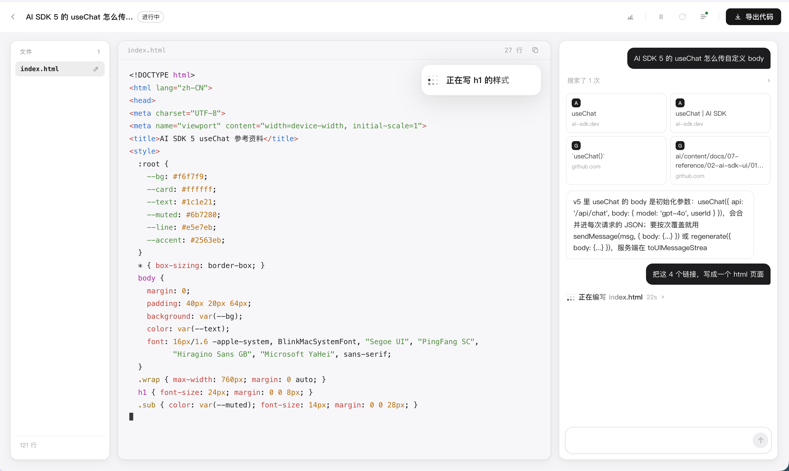

<div align="center">

# Step Coding

**看 AI 一行一行把代码打出来。**

不是「转圈 30 秒，然后一屏代码」，而是「一步一步，每一步都看得见，也停得下来」。




</div>

---

## 和一般的 AI 代码助手不一样的地方

| | 常见做法 | 这里 |
|---|---|---|
| 执行 | 一次调用吐一屏代码 | 一轮只调**一个工具**，前一个播完再要下一个 |
| 观看 | 转圈等结果 | 逐字打出来，可暂停、可调速、可回看 |
| 纠正 | 等它做完再说 | 跑着直接插话，当前请求一落地就按新指令走 |

---

## 亮点

**一步一个动作，过程不是黑箱**
`think → look → ask → plan → write → finish`，每一步在时间线上占一行；展开能看到它说的原话、计划步骤、搜索来源。

**逐字回放，细到「正在写哪一块」**
代码区浮层说的是「「登录表单」里的标签」「导航里的链接」，不是 `<a>`、`.card` 这种选择器。

**随时插话 = 打断**
没有排队、不吞话：你发的那句会等当前请求落地，再作为新一轮的起点。上一轮已经写下的文件不会被撤销，但会被当作既成事实交给下一轮判断。

**改是改，不是重写**
`edit_file` 只动 `find → replace` 那一段，后端按当前内容逐字校验，对不上就把原文退回给模型重新对；`write_file` 覆盖已有文件必须显式 `overwrite`。想整份重写也做得到，但要说得出来。

**「说了」必须等于「做了」**
`say` / `finish` 里声称写了某个文件、项目里却没有，这句话会被退回去，逼它真的落盘；删不存在的文件直接报错。删除、新建、修改在时间线上都留痕。

**刷新、换设备都不丢现场**
会话在服务端（`seq / messages / files`），前端每次只发 `session_id + seq + 一句话`。同一个 `seq` 重发直接回放上次结果，网络抖一下不会把一轮跑两遍。

**产物只有前端文件**
不碰本地磁盘、不执行命令；生成的代码在浏览器内存里，需要时一键导出 zip。手机上是上下拖动分屏。

---

## 三十秒看懂

```
你   做一个待办清单
它   想     项目是空的，先看目录确认
     查看   项目目录
     计划   1 结构   2 样式   3 交互
     新建   index.html   清单结构
     新建   style.css    清单样式
     新建   app.js       增删与勾选
     完成   三个文件已就绪，直接打开 index.html
     自检   3 个文件 · 引用、类名、括号都通
```

每一行都是**真实的一次模型调用 + 一次工具执行**，不是把一份大输出切成几段播出来。

---

## 快速开始

```bash
python3 -m venv .venv
.venv/bin/pip install -r requirements.txt
cp .env.example .env            # 填 DEEPSEEK_API_KEY
cd web && pnpm install && pnpm build && cd ..
.venv/bin/python -m uvicorn backend.main:app --port 8790
open http://127.0.0.1:8790
```

开发时用热更新（后端 `--reload`，前端 vite）：

```bash
./dev.sh                        # 8790 + 5173
```

---

## 它是怎么跑的

```text
浏览器 pump()
   │  POST /api/step { session_id, seq, message? }
   ▼
FastAPI ── step_lock：seq 落后就回放上次结果，超前就 409
   │
   ├─ 有新消息 → 追加进历史，步数从这一步重新算
   ├─ 取最近 40 条历史（原样，不改写）
   ├─ 附一份项目清单：文件名 · 行数 · 大小（不进 system，保住上下文缓存）
   └─ 一次模型调用 → 只取第一个 tool_call
        │
        ▼
   fs 校验：没读过不许改、覆盖要 overwrite、find 必须逐字命中、正文不许是占位符
        │
        ▼
   回 event + changed（只回变化的文件）
        │
        ▼
   player：把这一步逐字演出来，演完再要下一步
```

**一轮只走一步**是刻意的：这样"正在做什么"永远是具体的、可停下的一步，而不是一个看不到内部的批处理。

---

## 靠谱这件事，落在代码里

| 问题 | 处理 |
|---|---|
| 网络抖、重复提交 | 同一个 `seq` 幂等，重发直接回放，不会多跑一轮 |
| 同一会话并发 | 服务端每个会话一把锁，超时后的重试不会让同一轮跑两遍 |
| 长时间任务 | 暂停 = 停画面也停循环；返回 = 现场冻结进「最近」，回来接着做 |
| 模型说做了其实没做 | 文件不存在就把这句话退回去 |
| 输出被 `max_tokens` 截断 | 检测到就提示拆小文件重试，不把半截 JSON 当合法参数 |
| 用量失控 | 按 `IP｜浏览器 id` 每日 token 限流，超额 429 |

---

## 配置

| 变量 | 默认 | 说明 |
|---|---|---|
| `DEEPSEEK_API_KEY` | — | 必填，模型与搜索共用 |
| `LLM_TIMEOUT` | `180` | 单次模型调用超时（秒） |
| `LLM_MAX_TOKENS` | `6000` | 单次输出上限；大文件被截断就往上调 |
| `LLM_RETRIES` | `1` | 超时 / 429 / 5xx 的重试次数 |
| `SEARCH_PROVIDER` | `deepseek` | 也可 `serper` / `bocha`，没配 key 时整条搜索链路关闭 |

搜索默认走 DeepSeek 自研 Search API，与模型同一个 key（¥5 / 1000 次成功请求，失败不计费）。**搜不搜由模型自己判断**，不是每个问题都搜。

---

## 测试

```bash
.venv/bin/pip install -r requirements-dev.txt
.venv/bin/python -m pytest -q
```

用脚本化的假模型跑断言，**不花 API 费用**。覆盖：动作参数校验、覆盖保护、`edit` 逐字命中、幂等 `seq` 与回放、会话恢复、并发只执行一次、超时与 5xx 重试、截断检测，以及完整一轮 `think → plan → write → finish` 和「说写了其实没写」的守卫。

前端分两层：`cd web && pnpm test` 跑播放器回归（速度只认 cps、插话停在半截、`edit` 逐字替换），`pnpm build` 里的 `tsc --noEmit` 把类型关。真实任务的质量评测还没做成固定任务集，这是路线图里的第一项。

---

## 目录

```text
backend/
├── main.py      /api/session、/api/step：会话、幂等 seq、并发锁
├── agent.py     唯一的循环：调模型 → 执行工具 → 回事件
├── tools.py     工具 schema（唯一一份）
├── actions.py   tool_call → 内部动作，参数校验
├── fs.py        文件操作与写入 / 编辑 / 删除保护
├── guards.py    撒谎守卫、重复守卫
├── prompt.py    系统提示词
├── context.py   look 用的项目清单与正文
├── session.py   内存 LRU + 落盘 + 增量 diff
└── search.py    联网搜索

web/src/
├── App.tsx      驱动循环、三栏布局、时间线、历史与恢复
├── player.ts    把 write / edit / delete 演出来（逐字、可在中间插入）
├── check.ts     写完自检：引用、类名、id、括号
└── zip.ts       导出代码
```

---

## 路线图

- **真实模型评测集** —— 固定任务 + 断言（最终文件、关键片段、步数），输出 token / 步数 / 通过率一张表。现在调提示词和裁剪参数只能手工跑一次看结果。
- **单步流式** —— 从发出到第一个动作回来有 20～30 秒是「正在分析」，把这段的 `content` 分片推到时间线的 live 行；工具调用仍整段解析，一步一动作不变。
- **会话列表上服务端** —— 「最近」现在只在 localStorage，换浏览器就空；按设备标识存到服务端即可，不做完整账号。

## 它不做什么

| | 为什么 |
|---|---|
| 不跑代码 | 要的是看懂，不是部署 |
| 不执行本地命令 | 生成的代码在浏览器内存里 |
| 不做账号与进度 | 它不是课程 |
| 默认不引框架 | 小例子里框架的噪音比内容多 |

## License

MIT
