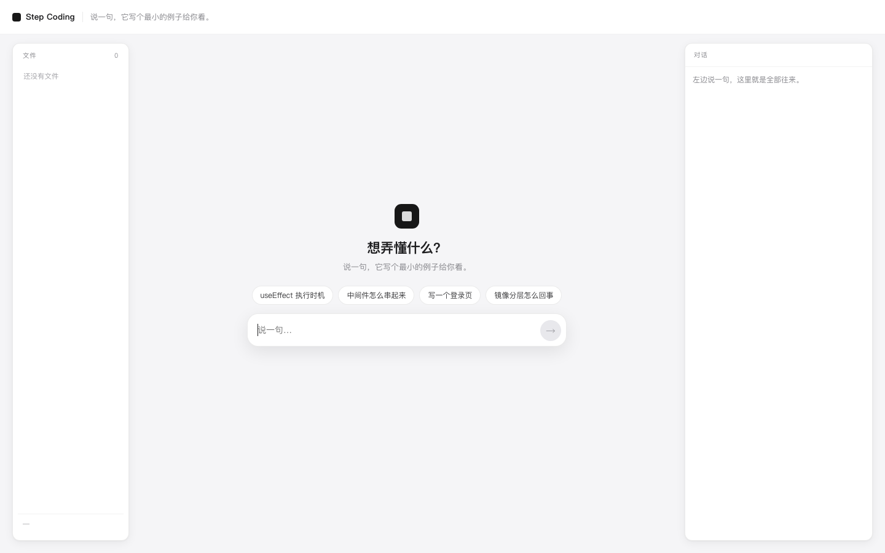
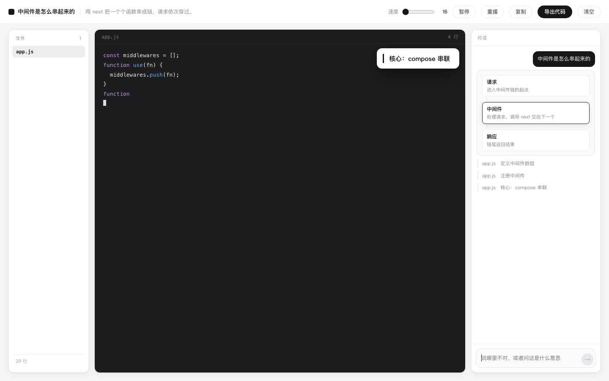

# Step Coding

> 哪个环节没看懂，说一句。它用一个最小例子，边写边讲给你看。



---

## 它解决什么

**写什么都行，只要你想看懂它长什么样。**

三种用法：

| 你想 | 它给 |
|---|---|
| 弄懂一个概念 | 「LangChain 的 Chain 怎么串起来的」→ 10 行代码 + 一条关系链 |
| 弄懂一个环节 | 「中间件是怎么串起来的」→ 4 个节点，逐段点亮 |
| 看一个界面长什么样 | 「写个登录页」→ index.html / style.css / app.js，一个个写出来 |




## 一轮完整的循环

右边不是聊天框，是**过程**（当前步骤另外从代码区右侧滑出）：

```
你     帮我写一个电商公司主页
       index.html　页面骨架和导航
       index.html　主视觉横幅
       index.html　商品卡片区
       style.css　 基础样式与导航
       style.css　 主视觉横幅样式
写完   2 个文件，90 行
它     检查了一遍：引用对得上，类名也都对得上，没发现问题。
```

只在**播完之后**才下结论，不在代码还没写完时说"改好了"。

查出问题会**自己回去改**，改完再查（最多两轮）：

```
它     检查查出 1 处问题：
       · style.css：写出来了，但 HTML 里没引用它
       index.html　页面骨架
       style.css　 居中布局
写完   3 个文件，70 行
它     检查了一遍：引用对得上，类名也都对得上，没发现问题。
```

检查是确定性的（`web/src/check.ts`），不调模型：

- 空文件
- HTML 引用的 css/js 是否真的在
- HTML 用到的类名，CSS 里有没有写
- JS 找的 `#id`，HTML 里有没有
- 括号有没有闭合

## 改已有的东西，是"改"，不是"重写"

模型交回的不是文件，是**操作**：

```
create  新建文件
append  在末尾接着写
edit    找到一段原文，换成新的     ← 真正改代码的样子
delete  删掉
```

所以「给登录按钮下面加个注册链接」只会产生一条：

```
index.html　按钮下加注册链接
```

而不是把整个登录页重新打一遍。原来的内容一个字符都不动。

模型能看到当前所有文件，只交回要动的那些：

```
你     再增加一个注册页面，登录页面可以跳转过去
       index.html　登录页加注册入口
       register.html　注册页表单结构
       register.html　注册页回登录的链接
写完   4 个文件，72 行        ← app.js 和 style.css 原样留着，没重写
```

三道保护：

- `edit` 的 `find` 必须逐字对上原文，后端会按顺序模拟一遍验证；
  对不上就把问题交回模型重写一次
- 还不行就降级成"整份重写这几个文件"（能做成就行，不卡住）
- 播放到一半你插话，会先把剩余步骤补完，再拿完整内容去改

## 可以聊

发「你好」不会开始写代码。它先回一句，等你把话说清楚。

讲解中途按暂停，右边输入框随时可以说话：说哪里不对，它改写一版；问「这里为什么这样」，它直接用话答。

## 三个设计决定

### 1. 中间只有代码

编辑区只放代码，不放别的东西。当前在写哪一段，从代码区右侧滑出一枚小浮层，
跟着步骤变，写完全部收起。

流程和关系图不占中间——它们出现在右边对话里，作为一张卡片：

```
请求进来
  ↓
执行中间件
  ↓
next 推进     ← 写到这一步时这里亮起
  ↓
响应返回
```

写界面时没有"关系"可讲，这张卡就不出现——**不为了一种形态牺牲另一种**。

### 1.5 只能看，不能跑

文件写出来就摆在那儿，可以切标签、可以复制。不执行、不预览。

这不是省事，是取舍：能跑就要沙箱、要依赖、要处理"为什么我的环境跑不起来"——那些和"看懂"无关。

### 2. 真实语法，但只留主干

不写伪代码（会把真实的坑抹掉），也不追求"能跑"（会带出 package.json、import、错误处理这些噪音）。

只留证明关系的那几行，其余全砍：

- ❌ import / 依赖 / 配置 / 启动脚本
- ❌ 错误处理样板、日志、注释块
- ✅ 真实语言的语法，能直接抄走

### 3. "最小"是硬约束，不是请求

生成后检查：文件 ≤ 4 个、步骤 ≤ 12 个、总代码 ≤ 160 行。超了在界面上标出来。

模型天然想写完整项目，靠 prompt 请求它"简单点"是没用的——必须用规则卡住。

---

## 跑起来

```bash
python3 -m venv .venv
.venv/bin/pip install fastapi "uvicorn[standard]"
cp .env.example .env            # 填 DEEPSEEK_API_KEY
cd web && pnpm install && pnpm build && cd ..
.venv/bin/python -m uvicorn backend.main:app --port 8790
open http://127.0.0.1:8790
```

**纯网页，不碰本地任何东西**：不读本地文件、不执行命令、不需要打开项目。

## 它不做什么

| | 为什么 |
|---|---|
| 不跑代码 | 最小例子要的是"看懂"，不是"部署" |
| 没有编辑器 | 你看的是它写，不是自己写 |
| 不做账号 / 进度 | 它不是课程 |
| 不读你的项目 | 最小示例讲通例；你的项目有它自己的写法 |
| 不做多语言深度支持 | 先让"一个环节讲清楚"这一件事成立 |

---

## 出问题了怎么查

后端每条请求都写一行 JSON 到 `logs/trace.jsonl`：

```json
{"event":"turn.start","files":{"index.html":808}}
{"event":"model.reply","ms":1044,"chars":96}
{"event":"turn.parsed","action":"reply","ops":0}
{"event":"validate.problems","problems":["第 1 个 edit 的 find 找不到"]}
{"event":"fallback.rewrite","paths":["index.html"]}
{"event":"turn.done","ops":3,"lines":105}
```

前端右上角有「日志 N」按钮（或 `?trace=1` 默认打开），记着每次发送、
拿到什么动作、播了几个 op、检查出几处问题。可以一键复制。

还有看门狗：等超过 75 秒会放开输入并提示，不会一直转圈。

## 结构

```
backend/
├── main.py      FastAPI：/api/explain + 静态托管
└── explain.py   一次调用生成教案（节点 / 步骤 / 代码），并做最小性检查

web/src/
├── App.tsx      提问页 + 讲解页（关系图 + 代码播放）
├── player.ts    播放器：按速度逐字吐出，可暂停/重播
└── styles.css
```

## 小技巧

- `?q=useEffect 什么时候执行` 直接出课（方便分享和截图）
- `?cps=120` 调播放速度
