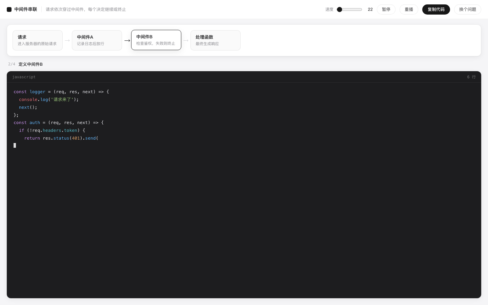

# Step Coding

> 哪个环节没看懂，说一句。它用一个最小例子，边写边讲给你看。


---

## 它解决什么

不是"教你编程"，是**解释一个你卡住的地方**：

- 「useEffect 到底什么时候执行」
- 「后端的中间件是怎么串起来的」
- 「数据库事务是怎么保证不出错的」

你带着问题来，它给你一个 **60 行以内**的最小例子，边写边讲，同时把**关系**画出来。



## 三个设计决定

### 1. 讲关系，不讲语法

代码上方是一条关系链，每写一段，对应的节点亮起：

```
[请求] ──▶ [中间件A] ──▶ [中间件B] ──▶ [处理函数]
                            ▲
                       正在写这一段
```

看不懂代码，本质不是不懂语法，是**不知道各部分之间是什么关系**。所以主角是这张图，代码是它的注解。

### 2. 真实语法，但只留主干

不写伪代码（会把真实的坑抹掉），也不追求"能跑"（会带出 package.json、import、错误处理这些噪音）。

只留证明关系的那几行，其余全砍：

- ❌ import / 依赖 / 配置 / 启动脚本
- ❌ 错误处理样板、日志、注释块
- ✅ 真实语言的语法，能直接抄走

### 3. "最小"是硬约束，不是请求

生成后检查：节点 2–4 个、步骤 3–6 个、总代码 ≤ 60 行。超了在界面上标出来。

模型天然想写完整项目，靠 prompt 请求它"简单点"是没用的——必须用规则卡住。

---

## 跑起来

```bash
python3 -m venv .venv
.venv/bin/pip install fastapi "uvicorn[standard]"
cp .env.example .env            # 填 DEEPSEEK_API_KEY
cd web && pnpm install && pnpm build && cd ..
.venv/bin/python -m uvicorn backend.main:app --port 8790
open http://127.0.0.1:8790
```

**纯网页，不碰本地任何东西**：不读本地文件、不执行命令、不需要打开项目。

## 它不做什么

| | 为什么 |
|---|---|
| 不跑代码 | 最小例子要的是"看懂"，不是"部署" |
| 不做账号 / 进度 | 它不是课程 |
| 不读你的项目 | 最小示例讲通例；你的项目有它自己的写法 |
| 不做多语言深度支持 | 先让"一个环节讲清楚"这一件事成立 |

---

## 结构

```
backend/
├── main.py      FastAPI：/api/explain + 静态托管
└── explain.py   一次调用生成教案（节点 / 步骤 / 代码），并做最小性检查

web/src/
├── App.tsx      提问页 + 讲解页（关系图 + 代码播放）
├── player.ts    播放器：按速度逐字吐出，可暂停/重播
└── styles.css
```

## 小技巧

- `?q=useEffect 什么时候执行` 直接出课（方便分享和截图）
- `?cps=120` 调播放速度
